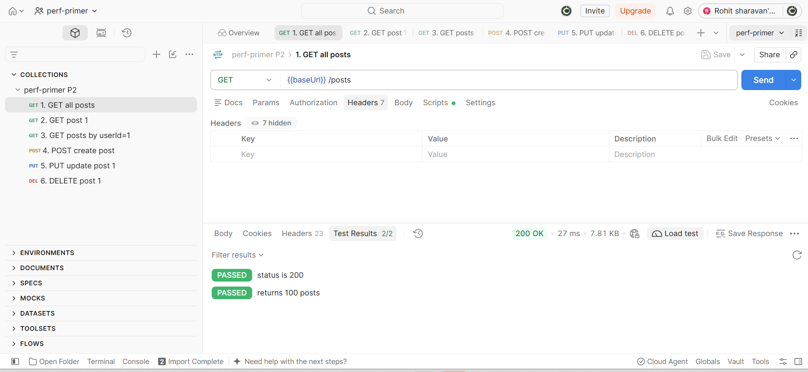
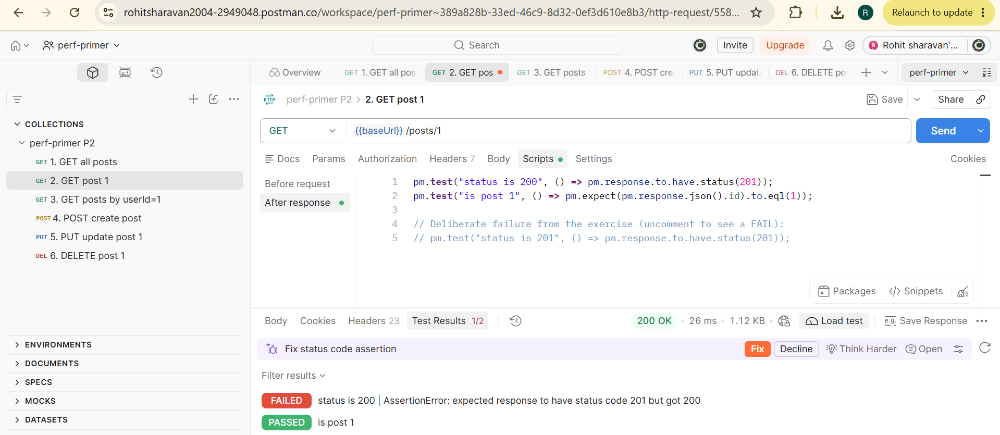

# P2.2 – Calling APIs with Postman

Tutorial followed: Postman Learning Center, "Send your first API request".
Practice API: JSONPlaceholder (`https://jsonplaceholder.typicode.com`). It's a fake REST API, so POST/PUT/DELETE give realistic responses but nothing is really saved.

Rule I stuck to: **single manual calls only.** Never loop or load-test a public API. Load tests go against our own app.

Exported collection: [`postman/perf-primer-p2.postman_collection.json`](../postman/perf-primer-p2.postman_collection.json)
Environment: [`postman/perf-primer.postman_environment.json`](../postman/perf-primer.postman_environment.json)

## The six calls

Sent from the Postman web app using the **Cloud Agent**, with the `perf-primer` environment selected. Times and sizes are what Postman showed for one run each.

Summary:

| # | Request | Status | Time | Size | Tests |
|---|---|---|---|---|---|
| 1 | GET /posts | 200 OK | 27 ms | 7.81 KB | 2/2 passed |
| 2 | GET /posts/1 | 200 OK | 25 ms | 1.12 KB | 2/2 passed |
| 3 | GET /posts?userId=1 | 200 OK | 27 ms | 1.9 KB | 2/2 passed |
| 4 | POST /posts | 201 Created | 27 ms | 1.09 KB | 2/2 passed |
| 5 | PUT /posts/1 | 200 OK | 42 ms | 1006 B | 2/2 passed |
| 6 | DELETE /posts/1 | 200 OK | 33 ms | 910 B | 1/1 passed |

Why so fast? The Cloud Agent sends requests from Postman's servers, which sit close to the API's servers, so there's hardly any network distance. When I called the same API from my own laptop with curl, it took 270–1000 ms. Same API, very different numbers. That's a good reminder that **where you test from changes the response time**, which matters a lot when reading load test results.



### 1. GET {{baseUrl}}/posts
- **Status:** `200 OK`
- **Headers:** `Content-Type: application/json; charset=utf-8`, `Cache-Control: max-age=43200` (the response can be cached for 12 hours)
- **Body:** a JSON array of **100 posts**, each with `userId`, `id`, `title`, `body`
- **Time:** 27 ms (7.81 KB)

### 2. GET {{baseUrl}}/posts/1
- **Status:** `200 OK`
- **Headers:** `Content-Type: application/json; charset=utf-8`, `Content-Length: 292`
- **Body:** a single object
  ```json
  { "userId": 1, "id": 1, "title": "sunt aut facere repellat provident occaecati excepturi optio reprehenderit", "body": "quia et suscipit..." }
  ```
- **Time:** 25 ms (1.12 KB)

### 3. GET {{baseUrl}}/posts?userId=1
- **Status:** `200 OK`
- **Headers:** `Content-Type: application/json; charset=utf-8`, `Cache-Control: max-age=43200`
- **Body:** an array of **10 posts**, all with `userId: 1`. The query string filtered the 100 down to 10.
- **Time:** 27 ms (1.9 KB)

### 4. POST {{baseUrl}}/posts
Request body (raw → JSON):
```json
{ "title": "perf primer", "body": "my first POST", "userId": 1 }
```
- **Status:** `201 Created` (not 200; a successful create returns 201)
- **Headers:** `Location: https://jsonplaceholder.typicode.com/posts/101` (where the new thing lives), `Cache-Control: no-cache`
- **Body:** my data echoed back plus a new id
  ```json
  { "title": "perf primer", "body": "my first POST", "userId": 1, "id": 101 }
  ```
- **Time:** 27 ms (1.09 KB)

### 5. PUT {{baseUrl}}/posts/1
Request body:
```json
{ "id": 1, "title": "updated title", "body": "updated body", "userId": 1 }
```
- **Status:** `200 OK`
- **Headers:** `Content-Type: application/json; charset=utf-8`, `Content-Length: 82`
- **Body:** the replaced post
  ```json
  { "id": 1, "title": "updated title", "body": "updated body", "userId": 1 }
  ```
- **Time:** 42 ms (1006 B)

### 6. DELETE {{baseUrl}}/posts/1
- **Status:** `200 OK`
- **Headers:** `Content-Type: application/json; charset=utf-8`, `Content-Length: 2`
- **Body:** `{}` (empty object; nothing left to return)
- **Time:** 33 ms (910 B)

What I noticed: the GETs come back with `Cache-Control: max-age=43200`, but the POST/PUT/DELETE responses say `no-cache`. That makes sense, since you don't want a "create" or "delete" answer cached.

## Environment variable: baseUrl

Instead of typing the full address in every request:
1. Environments → **+** → name it `perf-primer`.
2. Add a variable `baseUrl` = `https://jsonplaceholder.typicode.com`.
3. Select `perf-primer` in the environment dropdown (top right).
4. Write requests as `{{baseUrl}}/posts`, `{{baseUrl}}/posts/1`, and so on.

Why it's worth it: if the server changes (say, from a test server to `https://localhost:5001`), I change one value and every request follows. JMeter has the same idea with "User Defined Variables".

## Test in the Scripts tab

On `GET {{baseUrl}}/posts/1`, Scripts → **After response**:

```js
pm.test("status is 200", () => pm.response.to.have.status(200));
```

Sent it: **Test Results 2/2, PASSED: status is 200**.

Then I broke it on purpose by changing only the expected code to 201:

```js
pm.test("status is 200", () => pm.response.to.have.status(201));
```

Sent it again: **Test Results 1/2, FAILED: status is 200 | AssertionError: expected response to have status code 201 but got 200**.



Funny detail: it says "FAILED status is 200" because I only changed the number, not the test's name. The name is just a label I write. What actually decides pass or fail is the code inside. A badly named test can be misleading, so the name should always match what the test checks.

After that I changed it back to 200.

The request itself still worked fine and the server still returned 200. What failed was *my check*. That's exactly what JMeter calls an **assertion**: a rule that decides whether a response counts as a pass, separate from whether the server answered at all.

I put the correct status check on every request in the collection (200 for the GETs, PUT and DELETE; 201 for the POST), plus a couple of body checks, like 100 posts in the list and every post in the filtered list having `userId` 1.

## Saving and exporting

1. Saved all six requests into a collection called **perf-primer P2**.
2. Collection → **⋯** → **Export** → Collection v2.1 → saved into the repo as `postman/perf-primer-p2.postman_collection.json`.
3. Environment → **⋯** → **Export** → `postman/perf-primer.postman_environment.json`.

To use them on another machine: Postman → **Import** → pick both files → select the `perf-primer` environment → run.

## Self-check

**A request returns 200 OK but the body says `{"error":"not found"}`. Did it pass? What would you check to decide?**

Not necessarily. 200 only means the server answered without an HTTP-level error. The body says the thing I asked for wasn't found, so from a user's point of view it failed. (Some APIs wrongly return 200 for errors.)

To decide, I'd check the **body**, not just the status:
- Is there an `error` field? Then fail it.
- Does the body contain what I expected, like the right `id`, the right fields, or the expected count?
- Is `Content-Type` JSON as expected (not an HTML error page)?

In Postman or JMeter I'd add an assertion on the body, for example `pm.expect(pm.response.json()).to.not.have.property("error")` or a check on the expected `id`, so that a "200 with an error inside" counts as a failure.
