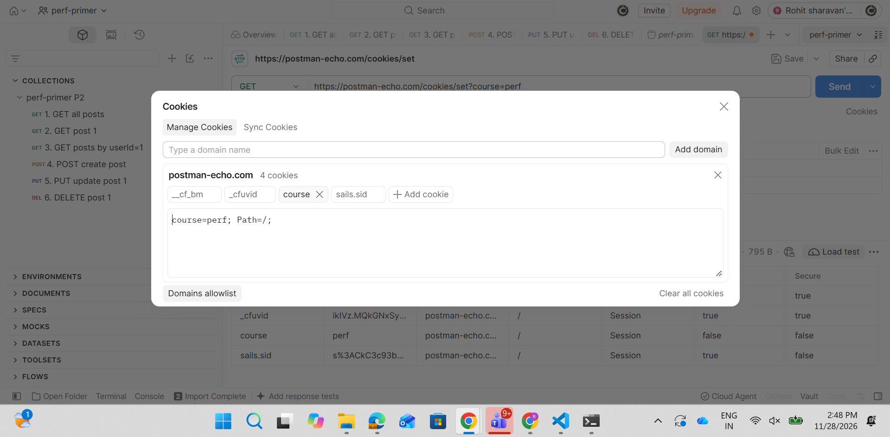
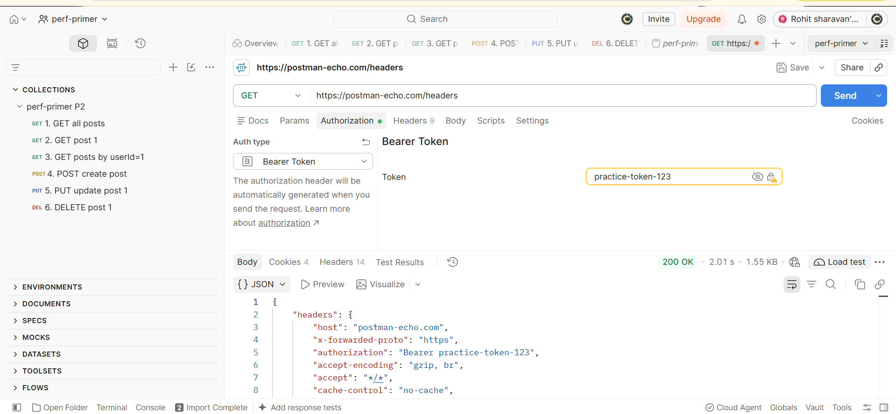

# P2.3 – Sessions, Cookies and Tokens; Browser DevTools

HTTP is stateless (see P2.1), so the server needs *something* in every request to know who's asking. The two common ways are cookies and bearer tokens. I tried both.

## 1. Cookies: the server sets it, the client sends it back automatically

**Call 1:** `GET https://postman-echo.com/cookies/set?course=perf`

The server answered `302 Found` (a redirect to `/cookies`), and the important part was this response header:

```
Set-Cookie: course=perf; Path=/
```

That's the server saying "store this, and send it back to me from now on." (It also set a couple of its own cookies, like a session ID `sails.sid` marked `HttpOnly`, and some Cloudflare ones.)

**Call 2:** `GET https://postman-echo.com/cookies`

I didn't add anything myself, but Postman's cookie jar sent the stored cookie along with the request, and the server echoed it back:

```json
{ "cookies": { "course": "perf", "__cf_bm": "...", "_cfuvid": "..." } }
```

**Same call with no stored cookies** (cleared the cookie jar) → `{ "cookies": {} }`. The server has no idea who I am anymore.

In Postman you can see this under **Cookies** (below the Send button), where `postman-echo.com` now has a `course` cookie.



## 2. Bearer token: the client has to add it itself, every time

**Call:** `GET https://postman-echo.com/headers` with the header
`Authorization: Bearer practice-token-123`
(In Postman: Authorization tab → Type: Bearer Token → `practice-token-123`.)

The echoed response had it right there:

```json
{ "headers": { "host": "postman-echo.com", "authorization": "Bearer practice-token-123", "accept": "*/*", ... } }
```



## 3. Cookie vs bearer token: the difference I saw

| | Cookie | Bearer token |
|---|---|---|
| Who decides to keep it | The **server** tells the client to store it (`Set-Cookie`) | The **client** gets it (usually from a login response) and keeps it itself |
| How it's sent | **Automatically** by the browser or Postman's cookie jar on every request to that site, in the `Cookie:` header | **Manually**: my code (or Postman setting) must add `Authorization: Bearer <token>` to **every** request |
| What happened in my calls | Call 2 had the cookie without me doing anything | Without me adding the header, there'd be no token at all |
| Typical use | Websites with logins (session ID) | APIs, mobile apps, single-page apps |

**Why this matters for JMeter:** a cookie needs an **HTTP Cookie Manager** so each virtual user stores and resends its own cookies. A token needs me to **pull the token out of the login response** and add it as an `Authorization` header on every following request. If I forget either one, every request after login looks anonymous and probably fails with 401.

## 4. JWT: the three parts

From the jwt.io introduction. A JWT (JSON Web Token) is a common kind of bearer token. It looks like three chunks of Base64 text joined by dots:

```
xxxxx.yyyyy.zzzzz
header.payload.signature
```

1. **Header:** what kind of token it is and which algorithm signs it, e.g. `{"alg": "HS256", "typ": "JWT"}`.
2. **Payload:** the *claims*, i.e. information about the user and the token, e.g. `{"sub": "1234", "name": "Test User", "exp": 1735689600}`. `sub` = who it's about, `exp` = when it expires.
3. **Signature:** the header and payload signed with a secret key. The server checks it to make sure nobody changed the token.

Key points:
- The payload is **encoded, not encrypted**. Anyone holding the token can decode and read it, so no passwords or secrets go in there.
- The signature stops people **changing** the token, not **reading** it.
- **A real token is like a password.** Never paste one into a website (including jwt.io's decoder), a chat, or an AI tool. I only used the fake `practice-token-123`.

## 5. Chrome DevTools: Network tab

Steps:
1. Open Chrome → `F12` (or `Ctrl+Shift+I`) → **Network** tab.
2. Tick **Preserve log** so the list isn't wiped when the page navigates or redirects.
3. Load a site (I used `https://jsonplaceholder.typicode.com/posts/1`).
4. Click a request in the list to see its details.

For one request (`GET /posts/1`):
- **Method:** `GET`
- **Status:** `200 OK`
- **Request headers:** e.g. `Accept`, `User-Agent`, `Cookie` (if the site has set any)
- **Response headers:** `Content-Type: application/json; charset=utf-8`, `Cache-Control: max-age=43200`
- **Cookies tab:** request cookies sent and response cookies set (`Set-Cookie`)


## 6. The Timing tab: every phase


| Phase | What's happening |
|---|---|
| **Queueing** | The browser has the request but hasn't started it yet, e.g. waiting for a free connection or behind higher-priority requests. |
| **Stalled** | Similar: waiting before it can be sent. |
| **DNS Lookup** | Turning the host name into an IP address. Skipped if it's already cached. |
| **Initial connection** | Opening the TCP connection to the server (the handshake). |
| **SSL / TLS** | Setting up encryption for https. Part of the initial connection. |
| **Request sent** | Actually sending the request. Usually tiny. |
| **Waiting for server response (TTFB)** | Time from the request being sent until the **first byte** of the response arrives. |
| **Content Download** | Receiving the rest of the response body. Depends on size and bandwidth. |

To check, I measured the same request from the command line once (cumulative times):

```
DNS done:        0.010 s
TCP connected:   0.084 s
TLS done:        0.185 s
first byte:      0.323 s   → server wait ≈ 0.323 − 0.185 ≈ 0.14 s
total:           0.324 s   → download ≈ 0 s (tiny response)
```

So for this small request, setting up the connection (DNS + TCP + TLS) took longer than the server's actual work.

## 7. Which phase is the server's own processing time?

**Waiting for server response**, often called **TTFB (Time To First Byte)**.

That's the gap where the request has arrived and the server is doing its work (running code, querying the database) before it sends anything back. Strictly, it also includes one network round trip, but when TTFB grows as load increases, that's the server struggling. That's exactly what a load test is looking for. The other phases are mostly about the network and the browser.

## Self-check

**"You log in once and the next request is still recognised. Name two ways the server could know it is you."**

1. **A session cookie.** At login the server sent `Set-Cookie: sessionId=...`. The browser sends `Cookie: sessionId=...` automatically on every later request, and the server looks up that session ID to find out who I am.
2. **A bearer token (often a JWT).** At login the server returned a token. The client adds `Authorization: Bearer <token>` to every later request, and the server checks the token's signature and reads who I am from it.
