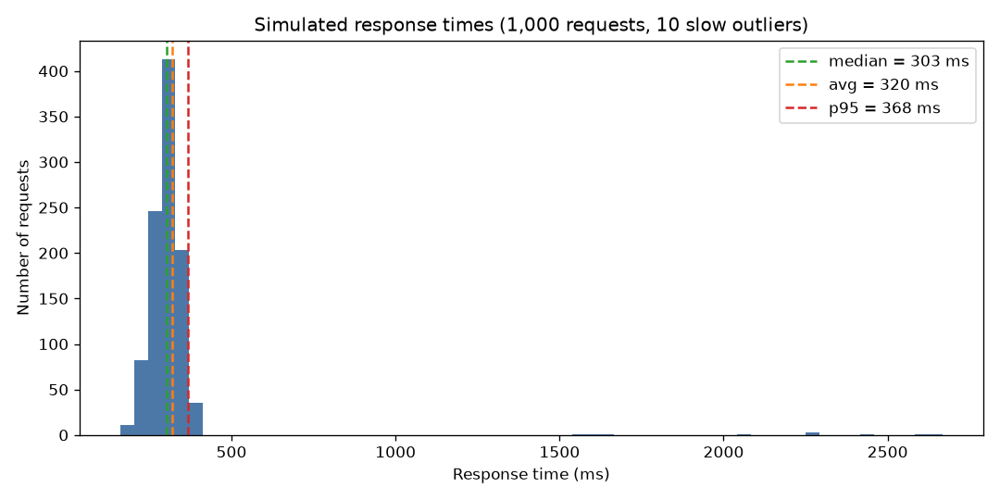
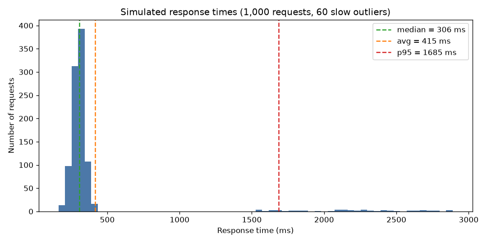

# P3.3 – The Numbers of Performance

Script: [`tools/p3_stats.py`](../tools/p3_stats.py) · Histogram: [`p3-histogram.png`](p3-histogram.png)

## 1. By hand: 10 response times

`120, 130, 125, 140, 135, 128, 132, 138, 127, 2400` (ms)

First I sorted them, because median and percentiles only make sense on sorted data:

`120, 125, 127, 128, 130, 132, 135, 138, 140, 2400`

**Average:** add them all up and divide by how many there are.
120 + 125 + 127 + 128 + 130 + 132 + 135 + 138 + 140 + 2400 = **3575**
3575 ÷ 10 = **357.5 ms**

**Median:** the middle value. With 10 values there are two middle ones (5th and 6th), so take the halfway point.
(130 + 132) ÷ 2 = **131 ms**

**90th percentile (p90):** the value that 90% of requests are at or below.
90% of 10 = 9, so it's the 9th value in the sorted list → **140 ms**.
(pandas gives 366 ms for the same data because by default it *interpolates* between the 9th and 10th values: 140 + 0.1 × (2400 − 140) = 366. With only 10 values, one slow request pulls it a lot. With hundreds or thousands of samples, the two methods come out almost the same.)

**What the average hides:** nine out of ten users got about 130 ms and one waited 2.4 seconds, yet the average says "357 ms", a number that *nobody* actually experienced. It's too slow to describe the nine and far too fast to describe the one.

## 2. In Python: 1,000 simulated response times

990 "normal" requests around 300 ms (±40 ms) plus 10 slow outliers between 1.5 and 3 s, with a fixed random seed (7) so the numbers repeat every run.

```
> python tools/p3_stats.py
1,000 response times, 10 slow outliers
   avg:    319.6 ms
median:    302.6 ms
   p90:    352.3 ms
   p95:    367.7 ms
   p99:    423.3 ms
   max:   2666.5 ms
```

How I read it:
- **median 303 ms:** a typical request.
- **avg 320 ms:** already ~17 ms higher than the median. Just 10 slow requests out of 1,000 dragged it up.
- **p90 / p95 / p99 (352 / 368 / 423 ms):** 99% of users got under about 0.4 s. The 10 outliers are only 1%, so they sit *above* p99.
- **max 2667 ms:** one unlucky request. Worth knowing about, but a single value says nothing about how most users felt.



The histogram makes it obvious: one tall block around 300 ms, then a long empty gap and a few tiny bars out at 1.5–2.7 s. That's the classic "long tail".

## 3. From 10 outliers to 60

```
> python tools/p3_stats.py --outliers 60
1,000 response times, 60 slow outliers
   avg:    414.6 ms
median:    306.2 ms
   p90:    367.7 ms
   p95:   1685.0 ms
   p99:   2645.6 ms
   max:   2889.3 ms
```

| Statistic | 10 outliers | 60 outliers | Moved? |
|---|---|---|---|
| median | 302.6 | 306.2 | **Barely.** It only cares about the middle. |
| p90 | 352.3 | 367.7 | **Barely.** 6% slow is still above the 90% line. |
| avg | 319.6 | 414.6 | **Yes, +95 ms.** Every slow value pulls on it. |
| p95 | 367.7 | 1685.0 | **Jumped.** 6% slow > 5%, so the slow ones now cross the p95 line. |
| p99 | 423.3 | 2645.6 | **Jumped.** Now well inside the slow group. |
| max | 2666.5 | 2889.3 | A little. It's just the single worst one. |

What I take from this:
- The **median and p90 didn't notice** that 6% of users were now waiting 1.5–3 seconds.
- The **average moved, but in a misleading way**. 415 ms sounds "a bit slower", not "60 people waited seconds".
- **p95 and p99 are what caught it.** Once the slow share is bigger than 5% (or 1%), the matching percentile leaps into the slow range. That's why reports watch the high percentiles.



## 4. Three more numbers, one line each

- **Throughput:** how many requests the system finishes per second, e.g. 6,000 requests in a 60 s test = 100 requests/s.
- **Error rate:** failed requests ÷ total requests, e.g. 30 failed out of 6,000 = 0.5%.
- **Concurrency:** how many requests are in progress at the same moment, not how many users exist in total. 500 users who mostly sit reading a page might only mean 20 requests in flight at once.

## Self-check

**Why do performance reports use p95 rather than the average?**

Because the average blends the fast majority and the slow few into a number nobody actually got, and a handful of very slow requests can hide inside it or distort it. p95 tells you something concrete: "95 out of 100 requests were this fast or faster", so only 1 in 20 users had it worse. When the slow tail grows, p95 jumps (from 368 ms to 1685 ms in my run) while the average only drifts up and the median doesn't move at all. Targets like "p95 under 500 ms" describe what real users feel much better than "average under 500 ms".
